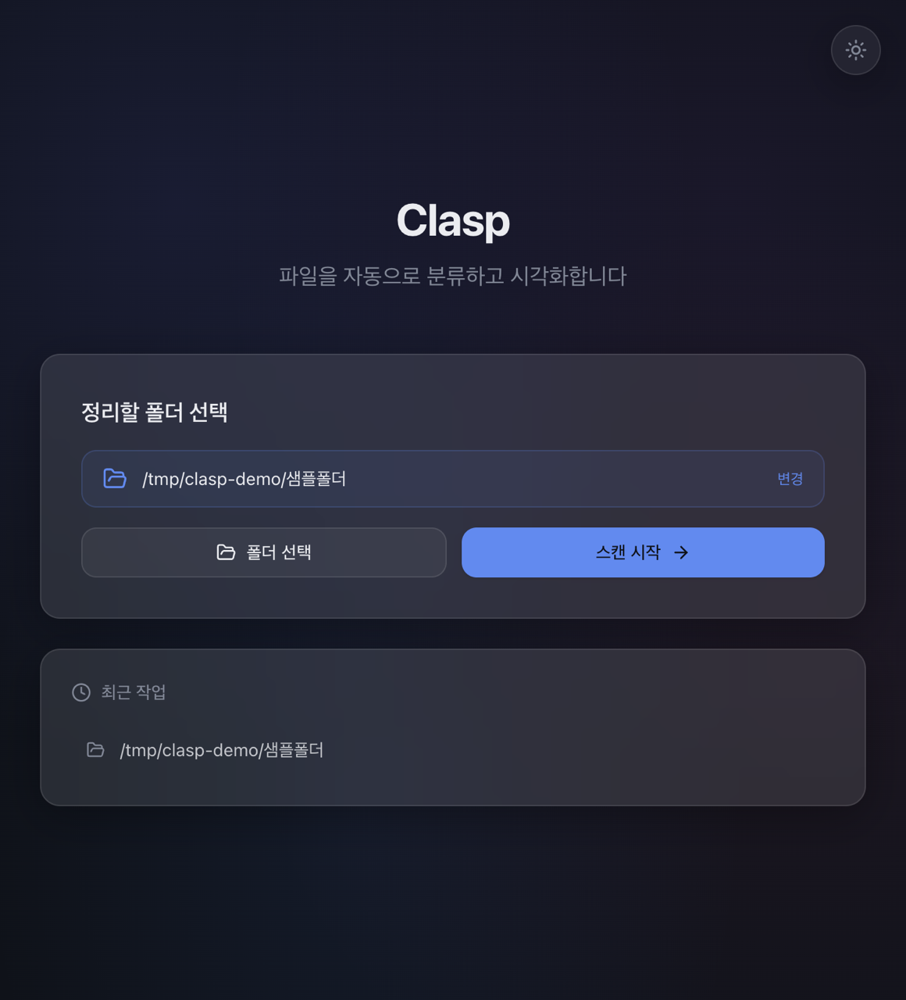
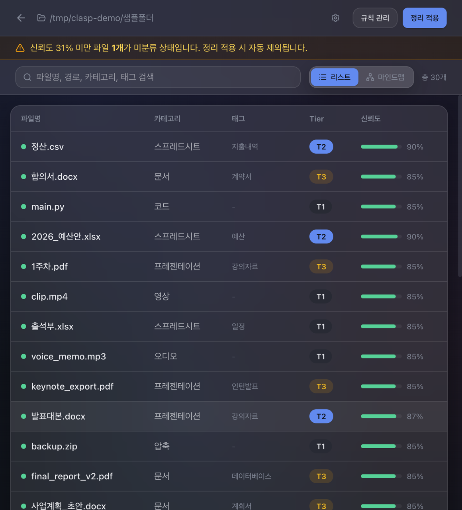
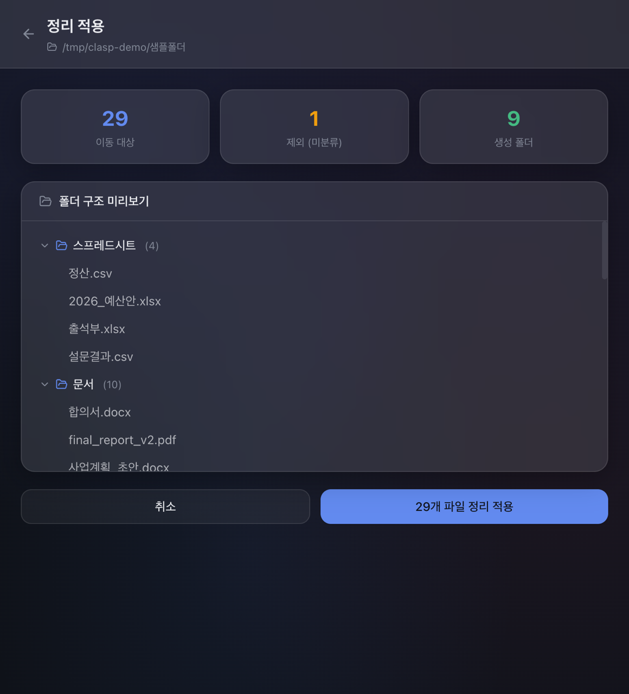
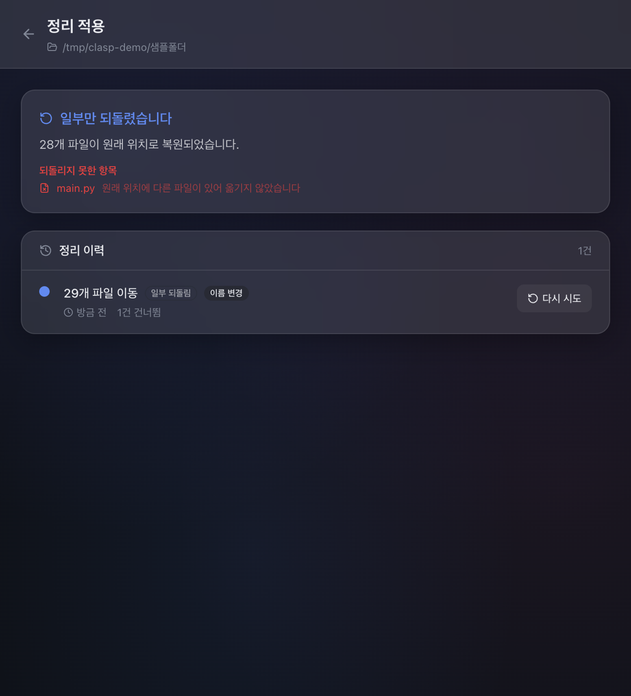
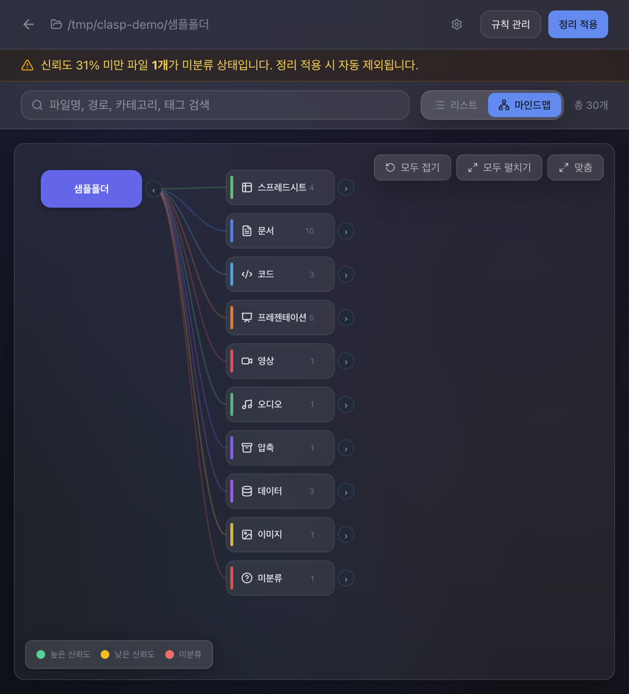
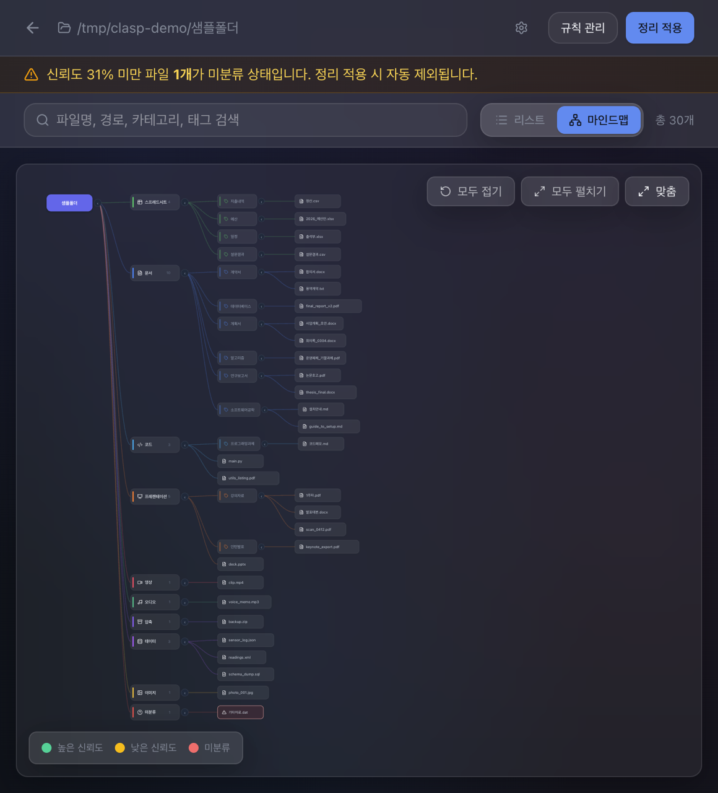
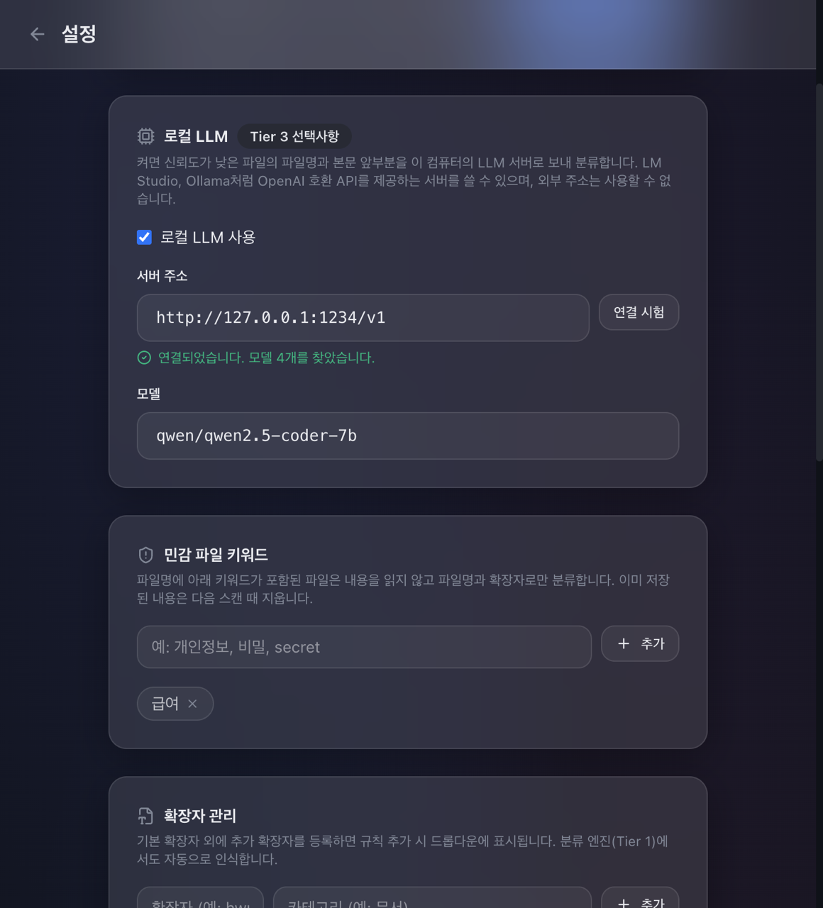
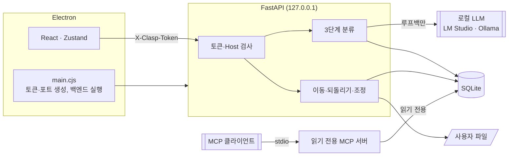

<div align="center">

# Clasp

**로컬 파일을 분류하고 마인드맵으로 보여 주는 프라이버시 우선 데스크톱 앱**

파일 내용을 이 컴퓨터 밖으로 보내지 않고 분류하며,
정리와 되돌리기가 사용자 파일을 덮어쓰지 않도록 설계했습니다.


[](https://github.com/KimHands/clasp/actions/workflows/ci.yml)

</div>

> [!IMPORTANT]
> macOS(arm64)에서 빌드와 실행을 확인했습니다. 앱은 서명되지 않았습니다. Windows는 CI에서 실패를 허용한 백엔드 테스트만 돌리며, 실제 빌드는 확인하지 않았습니다.
> 분류 정확도 수치는 직접 만든 소규모 합성 데이터의 회귀 감시용입니다. [평가 기록](docs/evaluation.md)을 참고하세요.

---

## 목차

- [기획 배경](#기획-배경)
- [사용 흐름](#사용-흐름)
- [화면 구성](#화면-구성)
- [주요 기능](#주요-기능)
- [안전·개인정보 설계](#안전개인정보-설계)
- [아키텍처](#아키텍처)
- [기술 스택](#기술-스택)
- [실행 방법](#실행-방법)
- [테스트](#테스트)
- [프로젝트 구조](#프로젝트-구조)
- [개발 현황](#개발-현황)
- [문서](#문서)
- [라이선스](#라이선스)

---

## 기획 배경

다운로드 폴더에 쌓인 파일을 손으로 분류하기는 번거롭고, 정리 서비스에 파일을 올리기는 꺼려집니다. 로컬에서 동작하는 AI 파일 정리 도구도 이미 여럿 있습니다. Clasp이 집중한 것은 그 다음 질문입니다. **실제 파일을 옮기는 프로그램을 어떻게 믿을 수 있는가.**

| 문제 | Clasp의 접근 |
|------|--------------|
| 파일 내용을 외부로 보내기 꺼려짐 | 로컬 임베딩과 로컬 LLM만 사용. 루프백이 아닌 주소는 코드에서 거부 |
| 정리하다 파일을 잃을까 걱정됨 | 덮어쓰기 옵션 제거. 이동 전 기록과 파일 식별값으로 잘못된 복원 방지 |
| AI의 판단을 믿어도 되는지 모름 | 분류 단계와 신뢰도 표시, 낮은 신뢰도 파일은 이동에서 제외 |
| 폴더 구조를 한눈에 보기 어려움 | 카테고리·태그·파일을 마인드맵으로 표시 |

---

## 사용 흐름

<table>
  <tr>
    <td align="center" width="25%"><br/><b>① 폴더 선택</b></td>
    <td align="center" width="25%"><br/><b>② 분류 결과 확인</b></td>
    <td align="center" width="25%"><br/><b>③ 미리보기와 적용</b></td>
    <td align="center" width="25%"><br/><b>④ 되돌리기</b></td>
  </tr>
</table>

**① 폴더 선택** 정리할 폴더를 고르고 스캔을 시작합니다. 메타데이터, 표지, 본문 추출, 분류, 유사도 계산까지 7단계 진행 상황이 표시됩니다.

**② 분류 결과 확인** 파일별 카테고리, 태그, 분류 단계, 신뢰도를 목록이나 마인드맵으로 봅니다. 결과가 틀리면 직접 고칠 수 있고, 수정한 값이 우선 적용됩니다.

**③ 미리보기와 적용** 어떤 폴더로 몇 개가 옮겨지는지 먼저 확인합니다. 이름이 겹치면 번호를 붙이거나 건너뛰며, 덮어쓰기는 없습니다.

**④ 되돌리기** 이력에서 과거 정리를 되돌립니다. 원래 위치에 다른 파일이 있으면 옮기지 않고 사유를 보여 주며, 자리를 비운 뒤 다시 시도할 수 있습니다.

> 화면의 파일은 모두 합성 데이터입니다. 분류 결과 화면의 T3는 로컬 LLM(LM Studio)을 켠 상태입니다.

---

## 화면 구성

<table>
  <tr>
    <td align="center" width="33%"><br/><sub><b>마인드맵</b><br/>카테고리별 파일 수</sub></td>
    <td align="center" width="33%"><br/><sub><b>펼친 마인드맵</b><br/>카테고리 → 태그 → 파일</sub></td>
    <td align="center" width="33%"><br/><sub><b>설정</b><br/>로컬 LLM · 민감 파일 키워드</sub></td>
  </tr>
</table>

---

## 주요 기능

| 기능 | 설명 |
|------|------|
| **3단계 분류** | 규칙 → 임베딩 → 로컬 LLM(선택). 각 결과에 분류 단계와 신뢰도를 남깁니다. |
| **근거 강도 구분** | `xlsx`처럼 형식이 분명한 확장자는 강한 근거, `pdf`처럼 범용 형식은 약한 근거로 다뤄 내용 분석이 뒤집을 수 있게 합니다. |
| **마인드맵** | 카테고리·태그·파일 계층을 접고 펼치며 탐색합니다. |
| **표지 유사도** | PDF·DOCX 표지를 찾아 유사한 파일을 그룹으로 묶고, 태그가 없는 파일에 그룹 태그를 붙입니다. |
| **규칙 관리** | 날짜·내용·확장자 규칙을 드래그 앤 드롭으로 우선순위와 계층을 정합니다. |
| **민감 파일 키워드** | 파일명에 키워드가 있으면 내용을 읽지 않고, 이미 저장된 내용은 다음 스캔 때 지웁니다. |
| **변경 감지 재스캔** | 변경 없는 파일은 다시 읽지 않습니다. 분류 설정이 바뀌면 그 폴더를 다시 분류합니다. |
| **읽기 전용 MCP 서버** | 에이전트가 분류 결과와 정리 계획을 조회합니다. 파일을 옮기는 도구는 없습니다. [자세히](docs/mcp.md) |

---

## 안전·개인정보 설계

실제 파일을 옮기는 프로그램이므로, 기능보다 잘못됐을 때의 동작을 먼저 정했습니다. 백엔드 동작은 pytest로 고정했고, Electron 설정과 소켓 측정은 실제 앱·실제 모델로 실행해 확인했습니다.

**파일 이동**
- 덮어쓰는 경로가 없습니다. 대상이 있으면 운영체제 수준에서 실패합니다(`os.link`).
- 옮기기 전에 파일 식별값(inode)과 함께 기록을 남깁니다. 중단되면 다음 실행 때 실제 파일과 대조해 정리합니다.
- 과거 배치를 되돌릴 때 그 자리의 파일이 그때 옮긴 파일이 아니면 옮기지 않습니다. 식별값은 이 설계 이후의 이동부터 기록됩니다.
- 스캔 때와 크기나 수정 시각이 다른 파일, 심볼릭 링크, 신뢰도 0.31 미만인 파일은 옮기지 않습니다.
- 선택한 폴더 밖으로 나가는 이동을 거부합니다.

**전송 경계**
- 파일 내용과 파일명은 루프백 주소의 LLM 서버로만 보냅니다. 외부 주소는 저장과 호출 단계에서 모두 거부하고, 프록시 설정과 리다이렉트도 따르지 않습니다.
- 로컬 LLM은 기본으로 꺼져 있습니다.
- 실제 백엔드와 모델로 스캔하며 소켓 연결을 기록했을 때, 연결은 로컬 LLM뿐이었습니다. `python -m eval.audit_sockets`로 다시 잴 수 있고, [원본 결과](docs/eval-results/socket-audit.json)가 있습니다.
- 임베딩 모델이 없으면 첫 스캔 때 Hugging Face에서 내려받습니다. 이때 파일 내용은 포함되지 않으며, 받은 뒤에는 캐시만 씁니다.

**LLM 출력 검증**
- LLM 응답은 파일 내용의 영향을 받으므로 신뢰하지 않는 입력으로 다룹니다. 허용 목록 밖의 카테고리는 버리고, 신뢰도는 0.85로 제한합니다.

**로컬 API**
- 실행마다 무작위 토큰과 포트를 정하고, 토큰이 없거나 Host가 루프백이 아니면 거부합니다.
- Electron은 sandbox를 켜고, 배포본에 CSP를 적용하며, 외부 페이지로의 이동을 막습니다.

**보장하지 않는 것**
- 같은 사용자 권한의 다른 프로세스가 이동 호출 사이의 극히 짧은 틈에 같은 경로를 바꾸는 경우는 막을 수 없습니다.
- 사용자가 지정한 로컬 LLM 서버가 받은 내용을 어떻게 처리하는지는 통제하지 못합니다.
- 하드링크를 지원하지 않는 파일시스템(exFAT 등)이나 다른 볼륨으로의 이동은 실패로 기록하고 파일을 그대로 둡니다.
- 프롬프트 주입 자체를 막지는 못합니다. 방어선은 출력 검증입니다.

설계 근거와 다른 벤더(Codex) 리뷰의 수용·기각 판정은 [파일 이동 안전 설계](docs/superpowers/specs/2026-11-04-safe-file-moves-design.md)와 [전송 경계 설계](docs/superpowers/specs/2026-11-04-transfer-boundary-design.md)에 있습니다.

---

## 아키텍처



### 분류 근거

| 근거 | 신뢰도 |
|------|--------|
| 수동 분류 | 1.0 |
| Tier 1·2 일치 | 큰 값 + 0.05 (최대 0.95) |
| 사용자 규칙, 형식이 분명한 확장자 | 0.85 |
| 파일명 패턴 (범용 형식만) | 0.82 |
| 범용 형식 (pdf, docx, txt 등) | 0.50 |
| Tier 2 임베딩 | 코사인 유사도 (Tier 1보다 높을 때 채택) |
| Tier 3 로컬 LLM | 응답값, 최대 0.85 (현재 값보다 높을 때 채택) |

---

## 기술 스택

| 영역 | 기술 |
|------|------|
| 데스크톱 | Electron 40 |
| 프런트엔드 | React 19 · Vite 7 · Tailwind CSS 4 · Zustand · dnd-kit |
| 백엔드 | FastAPI · Python 3.12 · SQLAlchemy 2.0 · SQLite |
| 분류 | sentence-transformers(`paraphrase-multilingual-MiniLM-L12-v2`) · OpenAI 호환 로컬 LLM |
| 문서 처리 | PyMuPDF · python-docx · openpyxl |
| 에이전트 연동 | MCP Python SDK (stdio) |
| 빌드 | PyInstaller · electron-builder |

---

## 실행 방법

확인한 버전은 Node.js 22, Python 3.12입니다.

```bash
git clone https://github.com/KimHands/clasp.git
cd clasp

# 백엔드 환경 (처음 한 번)
cd backend
python3.12 -m venv venv
venv/bin/pip install -r requirements.txt

# 앱 실행 (백엔드는 Electron이 띄웁니다)
cd ../frontend
npm install
npm run dev:electron
```

5173 포트를 다른 프로그램이 쓰고 있으면 `CLASP_VITE_PORT=5180 npm run dev:electron`처럼 바꿉니다.

**로컬 LLM(선택)** LM Studio나 Ollama의 서버를 켠 뒤 설정 화면에서 주소와 모델을 고릅니다. 없어도 Tier 2까지 동작합니다.

**배포 빌드** `./build.sh`를 실행하면 `frontend/release/`에 DMG가 만들어집니다. 임베딩 모델은 포함되지 않아 첫 스캔 때 내려받습니다.

---

## 테스트

```bash
cd backend
venv/bin/pip install -r requirements-dev.txt -r requirements-mcp.txt
venv/bin/python -m pytest                       # 241개 (2026-11-04 기준)
venv/bin/python -m eval.run --split holdout     # 분류 평가

cd ../frontend
npm run lint
npm run build
```

파일 이동 테스트는 임시 폴더에서 실제 파일을 옮깁니다. 전송 경계 테스트는 루프백이 아닌 소켓 연결을 차단하고 기록합니다.

### 분류 평가

직접 만든 합성 파일 38개로 잰 회귀 감시용 수치입니다. 보류 세트(14개)는 조정에 쓰지 않는 것을 원칙으로 했지만, 이 절차는 저장소 이력만으로 증명되지 않습니다. [원본 결과](docs/eval-results/)와 [해석](docs/evaluation.md)을 참고하세요.

| 조건 | 수정 전 | 수정 후 | 수정 전 고신뢰 오답 | 수정 후 고신뢰 오답 |
|------|---------|---------|---------------------|---------------------|
| 임베딩까지 | 11/14 | 12/14 | 3 | 0 |
| 로컬 LLM 포함 | 14/14 | 14/14 | 0 | 0 |

---

## 프로젝트 구조

```
clasp/
├── backend/
│   ├── engines/       3단계 분류 (tier1_rule · tier2_embedding · tier3_llm · pipeline)
│   ├── services/      스캔 · 이동(safe_move, action_service) · 조정(move_recovery)
│   ├── routers/       REST API
│   ├── mcp_server/    읽기 전용 MCP 서버
│   ├── eval/          분류 평가 도구
│   └── tests/         pytest
├── frontend/
│   ├── electron/      메인 프로세스 · preload
│   └── src/           pages · components · store · api
├── docs/              API · DB · 평가 · MCP · 설계 문서 · 스크린샷
├── .github/workflows/ CI
└── build.sh           배포 빌드
```

---

## 개발 현황

| 항목 | 상태 |
|------|------|
| 3단계 분류 · 마인드맵 · 규칙 관리 | ✅ |
| 덮어쓰지 않는 이동 · 조정 · 되돌리기 | ✅ |
| 로컬 전용 Tier 3 · 전송 경계 테스트 | ✅ |
| 로컬 API 토큰 · Electron 보강 | ✅ |
| 분류 근거 재설계 · 평가 도구 | ✅ |
| 읽기 전용 MCP 서버 | ✅ |
| macOS arm64 배포 빌드 | ✅ 실행 확인, 서명 안 됨 |
| Windows 빌드 | 🚧 미확인 |
| 태그 품질 | 🚧 임베딩 태그가 부정확한 경우가 있음 |

---

## 문서

| 문서 | 내용 |
|------|------|
| [`docs/API_명세서.md`](docs/API_명세서.md) | REST API |
| [`docs/database.md`](docs/database.md) | DB 스키마 |
| [`docs/extensions.md`](docs/extensions.md) | 기본 확장자 |
| [`docs/data-flow.md`](docs/data-flow.md) | 데이터 흐름 |
| [`docs/evaluation.md`](docs/evaluation.md) | 분류 평가 방법과 기록 |
| [`docs/mcp.md`](docs/mcp.md) | MCP 서버 연결과 설계 |
| [`docs/superpowers/specs/`](docs/superpowers/specs/) | 설계 문서와 리뷰 판정 |
| [`docs/archive/`](docs/archive/) | 개편 전 기록 |

---

## 라이선스

[MIT License](LICENSE)
